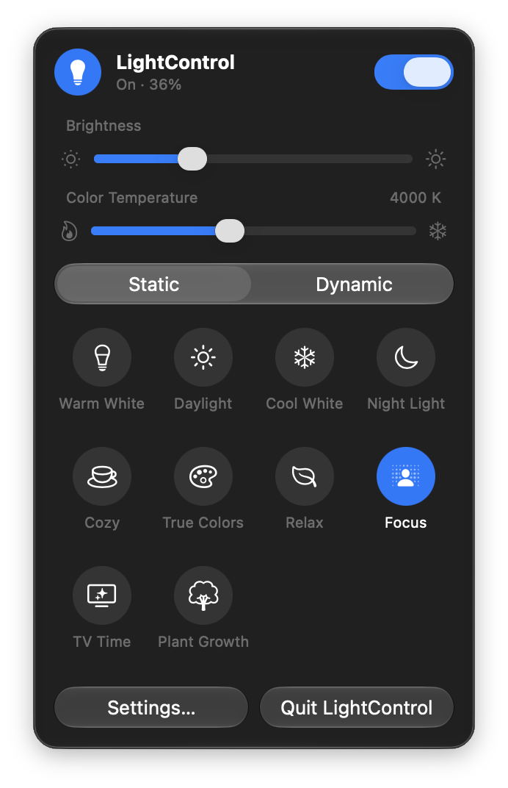
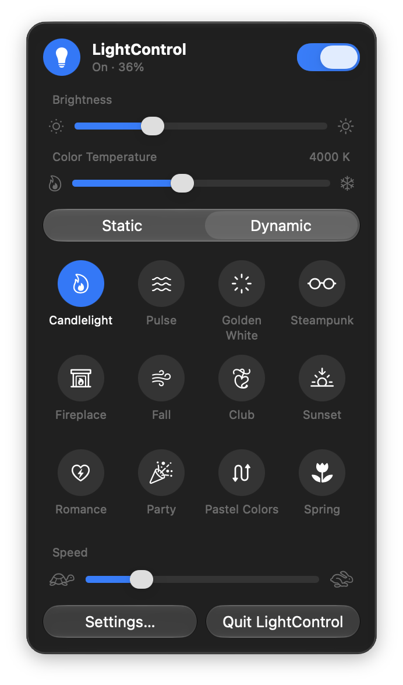
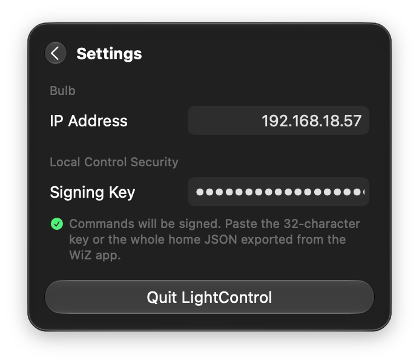

Wiz Light Control
================================
Control a Philips WiZ light from the Mac menu bar.

  
  
  

Requirements
==========
- macOS 13.0 or later (the Liquid Glass design needs macOS 26 or later)
- A WiZ bulb on the same network, with local communication allowed in the WiZ app

Functions
==========
- Turn on / off, with the bulb's current state shown each time the panel opens
- Set brightness
- Set color temperature
- Change scene (10 static, 23 dynamic)
- Set speed for dynamic scenes
- Sign commands with your home's UDP signing key, needed on newer WiZ firmware
- English, German and Chinese

Setup
==========
1. Click the lightbulb in the menu bar, then **Settings…**
2. Enter the IP address of the bulb.
3. If the bulb runs firmware 1.34 or later, paste your home's UDP signing key: either the 32-character key or the whole home JSON exported from the WiZ app, which contains it as `udp_signing_key`. Without it, newer bulbs reject every command.

The signing key is stored in the app's preferences. Keep it private: anyone with it can control your lights on your network.
